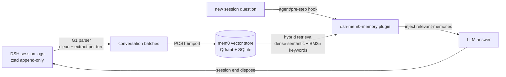

# dsh-mem0-memory — DSH conversation memory → mem0 vector store

> **🌐 Language**: [中文](README.md) | English

> **Status**: alpha (experimental). **In one line**: a DSH plugin + a CLI tool + a local service that automatically stores your DSH conversation memory into a mem0 vector store and recalls it in new sessions — **no more amnesia between conversations**.

---

## What problem does it solve

Every new DSH session starts with a model that is like an **employee on day one**: the plans you settled yesterday, the preferences you stated repeatedly, the pitfalls you hit last month — it knows none of it, and everything has to be explained from scratch. The longer you use sessions, the heavier this "amnesia tax" becomes — switch sessions and your accumulated context resets to zero.

Agent memory is not a new problem, and open source already has a battle-tested answer — **Mem0**: a memory layer built for AI agents that turns "conversation → fact extraction → semantic + keyword retrieval → context injection" into a standard pipeline. It is one of the most popular agent-memory projects on GitHub, and many agent products are built directly on it. We chose it because the path is proven and the ecosystem keeps evolving — **we don't need to reinvent memory, we just need to install it into DSH properly**.

**dsh-mem0-memory — a DSH memory plugin with deep Mem0 integration, built for the Chinese ecosystem**: it plugs mem0 memory into the DSH conversation loop and manages your conversation memory:

- **No more amnesia**: new sessions automatically carry relevant memories, no manual lookup
- **Chinese works out of the box**: jieba tokenization + Chinese fact extraction, precise Chinese keyword matching
- **Data stays on your machine**: fully local; in the most privacy-sensitive scenario it can run completely offline

Diagram:

```
Your DSH sessions (raw logs)
        ↓  memory ingestion
        ↓
   mem0 vector store (Qdrant + SQLite, semantic search)
        ↑  auto-recall search results before each turn
Your new session (answers with recalled memories)
```

## What it looks like after installation

**Before installation**, a fresh session asks:

> What exactly was that rule about "diagnose first, weigh options, get confirmation" I mentioned last time?

DSH answers: *Sorry, no relevant record in this conversation...*

**After installation**, the same question:

DSH automatically injects `<relevant-memories>` (a few related memories recalled from mem0) before replying, then answers accurately — it can even proactively cite last time's conclusions and lessons. Below is a **real recall transcript** (2026-08-20, content anonymized) — what gets injected for the query "diagnose first, weigh options, get confirmation before changing":

```xml
<relevant-memories>
The following memories were recalled from the Mem0 long-term memory store. Refer to them when answering the user's question.
<memory id="c445c0d1-...">The user decided not to rush changes to the plan document; align on the approach first.</memory>
<memory id="2a47dd0d-...">The user explicitly required: diagnose the problem first, present options, wait for confirmation before changing, and report what changed afterwards — never change things silently.</memory>
<memory id="736895ad-...">The user's preference "taking an extra step without confirmation even when the direction is right" was recorded as a signal to correct.</memory>
</relevant-memories>
```

The three memories rank in decreasing relevance (0.84 → 0.83 → 0.37) — hybrid retrieval injects by relevance, weak matches are still surfaced but ranked last, and the LLM decides what to use. This is a real recall from the actual memory store (anonymized), not a fabricated demo.

**Core capabilities**:
1. **Hybrid retrieval** — semantic vectors + BM25 keywords **fused and ranked together**: related meanings hit (vectors), exact names/IDs/paths hit (keywords); neither replaces the other
2. **Cross-session sharing** — all sessions write to the same memory store; a conclusion in session A is available in session B
3. **Automatic injection** — recall runs automatically before every real turn, zero manual work
4. **Incremental import** — only new messages are processed, no re-burning of tokens (per-session checkpoint)
5. **Workspace isolation** — workspaces whose names start with `0_` are never ingested (anti-pollution convention)

> Plain-language version: traditional retrieval is **matching words** (exact keyword match), while mem0 is **matching meaning** (semantic vectors) + **matching words** (keywords) on two channels — so even if you forgot the exact wording ("that conclusion from last time"), something semantically close still gets retrieved.

## Requirements (check before installing)

| Item | Requirement | Notes |
|---|---|---|
| DeepSeek Harness | rc.6+ (Developer Preview) | plugin host |
| Node.js | **≥ 23** (G1 tool uses node:zlib native zstd) | same install as DSH; check `node --version` |
| Python | 3.10+ | mem0 runtime |
| LLM API Key | DeepSeek (or any OpenAI-compatible) | fact extraction (memory ingestion) |
| Embedding API Key | any vector model service (Qwen, Jina, or any OpenAI-compatible endpoint); **local vector models also supported** (e.g. Ollama + bge-m3, zero API cost) | vectorization (memory retrieval) |
| Disk | ~1GB+ | memory store (vectors + history) |

> What you do **not** need: no GPU, no Docker, no self-hosted Qdrant server (local embedded mode), **no Mem0 cloud service**, **no pre-installed mem0** (the mem0 library and its dependencies are installed automatically by setup steps ②/④).

### Architecture in one sentence: a mem0 "custom-built machine" for DSH, with a setup service included

| Actual component | Metaphor | Notes |
|---|---|---|
| mem0 open-source library | Motherboard | official standard part, stable and reliable |
| Vector store = **Qdrant local mode** | Hard drive | mem0 supports several vector stores; we picked and configured Qdrant local (zero Docker, pip-installable, data on local disk) |
| LLM extraction = DeepSeek | CPU | default standard part, swappable with any OpenAI-compatible model |
| Embedding = Qwen3-8B | RAM | default standard part, recommended for Chinese, swappable with local models |
| **jieba Chinese tokenization** (BM25 keyword channel) | Chinese IME (custom part) | Chinese customization — stock mem0 is essentially unusable for Chinese keyword search |
| **G1 parser** (DSH sessions → memory batches) | Dedicated data interface card (custom part) | DSH customization — translates DSH conversation logs into memories |
| Degraded mode + keyword top-up + retrieval fixes | Circuit breaker (custom part) | custom retrieval hardening — offline recall even when the embedding model fails |

**A "full machine" needs every part — monitor, display, keyboard/mouse — or the whole thing is a paperweight**: the value loop (conversation → memory → retrieval → injection → conversation) is broken if any link is missing. That is also this project's delivery shape: **plugin + local service + dependency manifest, bundled as a three-piece set**.

- **Why not just buy the branded machine (Mem0 cloud)?**: ① you can't patch the Chinese fixes into a branded machine (no opening it up) — for Chinese use cases a custom-built machine is the only path that works ② memory data lives on a remote server, not locally ③ it costs money.
- **Setup service included** — one command installs every part (`setup.py`), and this README documents how to swap each part.

### Deployment shape & data sovereignty (important)

- **Runs fully local**: the memory store, vector store (Qdrant local), and fact history (SQLite) are all files on your disk — **data never leaves your machine**. The BM25 keyword model is also local (fastembed cache, works offline) — the keyword channel still recalls when the embedding API fails (automatic degradation).
- **The "mem0 service" is a thin local service shipped with the plugin**: it wraps the open-source mem0 library as HTTP endpoints (`/search` `/add` `/import` `/health`) — not an official cloud service, no dependency on Mem0 Cloud.
- **Only two outbound API calls**: ① LLM API (DeepSeek or any OpenAI-compatible, for fact extraction during ingestion) ② Embedding API (any vector model service). **Both can be swapped for local models** (e.g. Ollama + bge-m3 embedding, local LLM) — the most privacy-sensitive setup can be **fully offline**.
- **Chinese support**: works out of the box (see "Built-in patches" below).

## Quick install (~15-25 minutes first time)

> 5 steps total: **install plugin → install parts → set keys → power on → boot** (in machine terms: ① monitor + keyboard/mouse ② parts ③ power cable ④ chassis ⑤ power on). The slow parts are only the first model downloads in steps 2 and 4 — that's "waiting for a download", not hands-on work.

### Step 1: Install the plugin (pick one, ~1-2 min)

```bash
dsh plugin --profile web add github:kittitys/dsh-mem0-memory   # GitHub source (recommended)
# or
dsh plugin --profile web add dsh-mem0-memory                   # npm source
```

### Step 2: Install dependencies (~5-10 min, mostly the embedding model download)

```bash
pip install mem0ai qdrant-client fastembed jieba flask
```

### Step 3: Set API keys (~1 min)

```bash
export MEM0_LLM_API_KEY=xxx       # LLM API, fact extraction (memory ingestion)
export MEM0_EMBEDDING_API_KEY=xxx # embedding API, vectorization
```

> Keys can also go into a `.env` file at the project root (template: `scripts/.env.example`).

### Step 4: Initialize and start the memory service (~3-5 min, first run includes model download)

```bash
# Enter the plugin directory first (npm install location: $DSH_HOME/profiles/web/node_modules/dsh-mem0-memory/)
cd "$DSH_HOME/profiles/web/node_modules/dsh-mem0-memory"
python scripts/setup.py --init --install   # install deps + create the store
python scripts/mem0-server.py --port 18200 # start the service
```

> Windows users can use the bundled `scripts/start-server.bat`; consider registering it to auto-start on login.

### Step 5: Restart to activate (~2 min)

The plugin's own `cordis.patch.yml` is **merged into the profile configuration automatically** at install time (no need to add an enable entry manually). To tune parameters (e.g. memories injected per turn), append an override entry to `$DSH_HOME/profiles/web/cordis.patch.yml`:

```yaml
- id: mem0-memory
  config:
    limit: 5      # max memories injected per turn (default 5)
```

Then restart the DSH web profile (plugins have no hot reload) — **done ✅**

> After the restart, **run the first import once (next section)** and your history is in the memory store — from then on it's automatic and incremental, nothing else to manage.
>
> **Peer dependency warnings are safe to ignore**: pnpm may print `missing peer @deepseek-ai/cordis` / `@deepseek-ai/dsh-agent-loop` during install — this is a declarative warning; at runtime the plugin resolves these from the DSH bundle installation, nothing to do.

## First import: load your historical sessions into the memory store

```bash
# Incremental import (default; reads checkpoint; first run is automatically full)
dsh-mem0-import --since-last
# Common variants:
#   --full              full re-import (ignores checkpoint)
#   --session <file>    import only a specific session
#   --dry-run           show stats without writing anything
#   --server <url>      custom mem0-server address
#   --dsh-home <dir>    custom DSH data root (default $DSH_HOME)
# (After npm install, dsh-mem0-import is a global command; from a source checkout use the full path
#   node <package-dir>/bin/dsh-mem0-import.mjs, same arguments)
```

The first full import calls the LLM for fact extraction (token-billed; roughly a few cents to a few dollars per thousand sessions); after that, incremental imports are handled by the three-tier mechanism (below) with no manual management.

> **Can I skip the manual first import?** Yes — when the first session ends (dispose), auto-import runs a full import because there is no checkpoint yet. But note: **web sessions live a long time**, and dispose usually only happens on process exit/restart — meanwhile the store stays empty (your first conversation only enters the store when that session ends). **A manual first import is recommended** (the one command above) for immediate effect; after that it's fully automatic.

> **How long does the first import take?** Experience: **~1-2 min per batch** (vectorization + LLM fact extraction). New users (few historical sessions) ~**10-30 min**; heavy history (dozens of sessions) ~**1 hour+**. The biggest variable is API state — flaky vector/extraction APIs can double the time (just re-run later to resume). Interruptions are not scary: re-running only repeats the interrupted batch (mem0 hash dedup catches it), not from scratch.

## Daily use (invisible context injection while chatting)

- **During conversations**: the plugin recalls and injects automatically (~5-10s per turn, configurable skip)
- **Memory ingestion: three tiers, zero config by default** —
  - **① Auto (default)**: incremental import when the session ends (plugin hooks `session/disposed`, only processes messages since the last import, no repeated token burn)
  - **② Manual**: sync anytime with one command: `dsh-mem0-import --since-last` (command name works directly after npm install)
  - **③ Scheduled** (advanced): for a fixed cadence, use your OS scheduler (Windows Task Scheduler / cron / systemd timer) to run `dsh-mem0-import --since-last`
- **Tuning / inspecting config**: edit the `config` section in `$DSH_HOME/profiles/web/cordis.patch.yml` (see Step 5); to see the full composed configuration, use `dsh --profile web --dump-config`

> **Note**: this project only imports "in-conversation memory" (your DSH sessions); it does not process SESSION-STATE / other persistent files (e.g. USER, IDENTITY).

## Active search (query your memory like a search engine)

Auto-injection is "memory with no effort"; to **explicitly query** what's in the store, use `dsh-mem0-search` (shares the same store as auto-injection; hybrid/top-up/degraded all available):

```bash
dsh-mem0-search "上次说的消息格式规范"                              # default top 5, all sources
dsh-mem0-search "项目技术栈" --source DSH --limit 10              # only a specific source
dsh-mem0-search "8月的决定" --from 2026-08-01 --to 2026-08-31     # date window
dsh-mem0-search "关键词" --json                                   # raw JSON (script-friendly)
```

> Date-window queries use scroll + re-rank and normally take 20-60s (plain queries are much faster).

## Config reference

| Option | Default | Notes |
|---|---|---|
| `serverUrl` | `http://127.0.0.1:18200` | mem0 service address |
| `limit` | 5 | max memories injected per turn |
| `scoreThreshold` | 0.15 | relevance threshold (below → not injected) |
| `timeoutMs` | 20000 | recall timeout (on timeout, skip recall — conversation unaffected, only this turn's injected results are missing) |
| `source` | (empty) | recall only a specific source (multi-source setups) |
| `probePath` | (empty = off) | troubleshooting probe log path (only written when set) |
| `autoImport` | true | auto incremental import at session end (off = manual/scheduled only) |

## How it works



Mechanism details (ingestion, recall, incremental, anti-pollution) live in the feature sections above and the source (`lib/`, `bin/`, `scripts/`).

### Built-in patches (key customized capabilities, applied as patches)

The capabilities in the diagram — "hybrid retrieval", "Chinese support" — are delivered as **four patches**, applied automatically when the server starts:

> All customizations are applied via **monkey-patch (runtime replacement)** — **no files in the mem0 installation are modified**, `pip install -U mem0ai` upgrades won't lose the patches, and uninstalling the plugin leaves no trace. Any patch failure degrades gracefully (WARN log), conversations and imports are unaffected.
>
> Of the four patches, **the first three together make Chinese work out of the box**: jieba covers the **retrieval side** (Chinese keywords hit), extraction language keeps facts in Chinese on the **write side**, and the DeepSeek patch keeps the **extraction side** from spinning uselessly.

<details>
<summary>Patch details (click to expand)</summary>

| Patch | What it does | If it fails (WARN degradation only) |
|---|---|---|
| **jieba Chinese tokenization** (`lemmatize_for_bm25` ×3 call sites) | mem0's default spaCy English tokenizer fails on Chinese (continuous Chinese has almost no tokens under SPLADE encoding → the BM25 keyword channel is crippled). With jieba, both the **write side** (fact `text_lemmatized`) and the **query side** tokenize correctly, so Chinese keywords (proper nouns/IDs/paths) hit exactly across hybrid/top-up/degraded channels | Chinese keyword retrieval degrades (semantic retrieval still works) |
| **Extraction language** (`use_input_language=True`) | mem0 by default extracts facts into **English** — Chinese conversations get translated into English facts, breaking Chinese keyword retrieval. Forcing input-language extraction (Language Requirement section appended to prompt) | Facts extracted in English (cross-lingual semantic recall still works) |
| **DeepSeek patch** (thinking off + no response_format) | New DeepSeek models burn max_tokens on thinking by default (`finish_reason=length, content=""`) → mem0 silently ingests 0 facts; and v4-flash returns empty content on json_object + long prompts. Forcing it off makes mechanical extraction faster, cheaper, and always productive | DeepSeek users may extract 0 facts (no impact with other LLMs) |
| **API timeout** (embedding/deepseek 120s) | The official client sets no timeout; a hung API can block request threads | None (only prevents hangs) |

</details>

## Limitations & FAQ

| Question | Answer |
|---|---|
| How much slower will each reply be after install? | Measured: ~5-10s per turn for recall (synchronous injection). Occasional cold-start turns may exceed 15s. Set `timeoutMs` or disable the plugin for manual recall only |
| What if the embedding API goes down? | **The hybrid channel degrades automatically to keyword-only**: BM25 search is a local model (works offline), recall falls back to pure keyword matching with a `degraded` flag; if that also fails, recall is skipped for this turn and conversation continues unaffected |
| **How do the mem0 service and DSH relate? Are they independent?** | **Two completely independent processes**: DSH = Node process (conversation + plugin host); mem0 service = separate Python process (HTTP service, port 18200). Neither needs the other to start; the plugin only calls it over HTTP. **DSH crash/restart doesn't affect mem0**; **mem0 down doesn't affect DSH conversations** (recall is skipped automatically) |
| Does the mem0 service need to stay running? | Yes — it's the "brain" of memory; keep it running. If it's down: ① recall is skipped on the conversation side (chatting is fully normal, just amnesia across sessions) ② imports fail, that day's memory isn't updated (re-runnable later, no data loss) ③ manual queries error. **Data is never lost** — the store is disk files; the service recovers on restart |
| Can the memory store leak? | Local Qdrant + SQLite, never leaves the machine; API keys are only used for embedding/LLM extraction calls |
| Relation to "official memory"? | DSH has no built-in memory yet; this plugin is the community route |
| Can bad data be written into my session? | Injection follows the DSH message spec (id + content blocks); failed recall skips automatically, sessions are never corrupted |
| How does "auto incremental import" know where it stopped? | One checkpoint per session (`lastSeq`). No matter how often a session ends, it's never re-processed; a mid-run crash repeats at most one window, absorbed by mem0's exact-hash dedup |
| Windows support? | Core is cross-platform; bundled scripts work on Windows/Linux (Windows: `scripts/start-server.bat`, Linux/macOS: `scripts/start-server.sh`) |
| Plugin installed but not working? | ① Confirm `dsh plugin --profile web add` succeeded (plugin is in the profile bundles list) ② server-side plugins have no hot reload — restart DSH web after changes ③ enable `probePath` for probe logs to diagnose |

## Project status

- Experimental (alpha). Evaluate before production use.
- Known boundaries: DSH Developer Preview upgrades may break compatibility; mem0 v2 semantics (ADD-only + hash dedup); LLMs other than DeepSeek are not individually adapted (the DeepSeek patch only applies to it).
- Development history (including incident post-mortems and isolated verification) lives in the project docs; recall post-processing is ported from the OpenClaw `mem0-memory` plugin; zstd frame parsing is ported from DSH's official persistence source.
- **Feedback**: issues / PRs welcome (GitHub Issues). Updates may be slow, but recall quality and install issues get priority — the pits you hit are our tests.

## License

MIT (see LICENSE). *This project is not affiliated with DeepSeek.*
