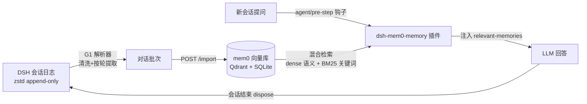

# dsh-mem0-memory — DSH 会话记忆 → mem0 向量库

> **🌐 语言/Language**: 中文 | [English](README.en.md)

> **状态**：alpha（实验性质）。**一句话**：一个 DSH 插件 + 一个命令行工具 + 一个本地服务，把你的 DSH 对话记忆自动存进 mem0 向量库，并在新会话里自动召回——**换对话不再失忆**。

---

## 解决什么问题

DSH 的每个新会话，模型都像**第一天上班**：昨天敲定的方案、反复强调的偏好、踩过的坑，它一概不知，一切从头解释。会话用得越久，这笔「失忆税」越明显——换一个会话，之前的积累全部归零。

Agent 记忆不是新问题，开源社区早有被大规模验证的答案——**Mem0**：专为 AI Agent 设计的记忆层，把「对话 → 事实提取 → 语义+关键词检索 → 上下文注入」整条链路做成标准件，是 GitHub 上最流行的 agent memory 项目之一，大量 agent 产品直接基于它构建。选它，是因为这条路被验证过、生态持续演进——**我们不需要重新发明记忆，只需要把它正确地装进 DSH**。

**dsh-mem0-memory——深度集成 Mem0、面向中文生态的 DSH 记忆插件**：把 mem0 记忆能力接入 DSH 对话循环，管理你的会话记忆：

- **换对话不失忆**：新会话自动带上相关记忆，不用手动查
- **中文开箱即用**：jieba 分词 + 中文事实提取，中文关键词精确命中
- **数据不出机器**：全本地运行，极致隐私场景可完全离线

示意图：

```
你的 DSH 会话（原始日志）
        ↓  记忆入库
        ↓
   mem0 向量记忆库（Qdrant + SQLite，语义检索）
        ↑  每轮对话前自动召回搜索结果
你的新会话（自动带上召回记忆回答问题）
```

## 安装后的效果

**安装前**，新会话提问：

> 我上次说的那个「先诊断、多方案对比、确认后再怎样怎样」的规矩具体是怎么回事来着？

DSH 答：*抱歉，这个对话里没有相关记录……*

**安装后**，同样的问题：

DSH 会在回复前自动注入 `<relevant-memories>`（从 mem0 召回的数条相关记忆），然后给出准确回答，甚至能主动引用上次的结论和教训。下面是**真实召回实录**（2026-08-20，内容已脱敏）——查询「动手前先诊断、多方案对比、确认后再改」时注入的内容：

```xml
<relevant-memories>
以下是从 Mem0 长期记忆中召回的相关记忆，优先参考这些内容回答用户问题。
<memory id="c445c0d1-...">用户决定不急着修改方案文档，先对齐方案再动手。</memory>
<memory id="2a47dd0d-...">用户明确要求：助手必须先诊断问题、给出多方案对比、等用户确认再改，改完告知变更内容，不准悄无声息地改。</memory>
<memory id="736895ad-...">用户偏好「方向对但未经确认就多走一步」被记录为待修正信号。</memory>
</relevant-memories>
```

三条记忆相关度依次递减（0.84 → 0.83 → 0.37）——混合检索按相关度排序注入，弱相关也带出但排在末尾，由 LLM 自行取舍。以上内容来自真实记忆库（脱敏），非虚构演示。

**核心能力**：
1. **混合检索召回**——语义向量 + 关键词 BM25 **双通道融合排序**：意思相近能命中（向量），名字/ID/路径精确命中（关键词），互不替代
2. **跨会话共享**——所有会话写同一个记忆库，A 会话的结论在 B 会话可用
3. **自动注入**——每轮真实对话前自动召回，零手动操作
4. **增量导入**——只处理新增消息，不重复烧 token（per-session checkpoint）
5. **工作区隔离**——名字以 `0_` 开头的工作区自动不入库（防污染约定）

> 通俗版：传统检索是**按字找**（关键词精确匹配），mem0 是**按意思找**（语义向量）+ **按词找**（关键词）双通道——哪怕你忘了原话（「上次那个啥结论」），意思相近也能被捞回来。

## 基础要求（安装前请确认）

| 项                 | 要求                                                                          | 说明                             |
| ----------------- | --------------------------------------------------------------------------- | ------------------------------ |
| DeepSeek Harness  | rc.6+（Developer Preview）                                                    | 插件宿主                           |
| Node.js           | **≥ 23**（G1 工具用 node:zlib 原生 zstd）                                          | 与 DSH 同装即可，检查 `node --version` |
| Python            | 3.10+                                                                       | mem0 运行环境                      |
| LLM API Key       | DeepSeek（或任意 OpenAI 兼容）                                                     | 用于事实提取（记忆入库）                   |
| Embedding API Key | 任意向量模型服务（千问、Jina，或任意 OpenAI 兼容端点）；**也兼容本地向量模型**（如 Ollama + bge-m3，零 API 成本） | 用于向量化（记忆检索）                    |
| 磁盘                | ~1GB+                                                                       | 记忆库（向量 + 历史）                   |

> 不需要的东西：不需要 GPU、不需要 Docker、不需要自建 Qdrant server（用本地嵌入式模式）、**不需要任何 Mem0 云服务**、**不需要预装 mem0**（mem0 库及其依赖由**安装步骤②/④自动安装**）。


### 一句话架构：这是一台专门用于 DSH 的 mem0 定制化「组装机」+ 搭配装机服务

| 实际部件                       | 比喻           | 说明                                                             |
| -------------------------- | ------------ | -------------------------------------------------------------- |
| mem0 开源库                   | 主板           | 官方标准件，稳定可靠                                                     |
| 向量库 = **Qdrant 本地模式**      | 硬盘           | mem0 支持多家向量库，我们选定并配置好 Qdrant local（优势：零 Docker、pip 即用、数据在本地磁盘） |
| LLM 提取 = DeepSeek          | 处理器          | 默认标准件，可换任意 OpenAI 兼容模型                                         |
| Embedding = Qwen3-8B       | 内存条          | 默认标准件，中文效果推荐配置，可换本地模型                                          |
| **jieba 中文分词**（BM25 关键词通道） | 中文输入法（定制件）   | 中文定制化——mem0 原版对中文关键词搜索基本不可用                                    |
| **G1 解析器**（DSH 会话 → 记忆批次）  | 专属数据接口卡（定制件） | DSH 定制化——把 DSH 的对话日志翻译成记忆                                      |
| 降级模式 + 关键词补捞 + 检索修复        | 电路保护器（定制件）   | 定制化检索增强——embedding 模型失效也能离线召回记忆                                |

**「一整套硬件」主机、显示器、键鼠缺一不可**——价值闭环（对话 → 记忆 → 检索 → 注入 → 对话）少一环整机就是摆设。这也是本项目的交付形态：**插件 + 本地服务 + 依赖清单，三件套捆绑**。

- **为什么不直接用品牌机（Mem0 云服务）**：① 中文补丁打不进去（品牌机不让拆机），对中文场景组装机是唯一能跑通的路 ② 记忆数据在远程服务器上，非本地 ③ 付费。
- **随包提供装机服务**——一条命令装好所有部件（`setup.py`），说明书（README）写清楚每个部件怎么换。

### 部署形态与数据主权（重要）

- **全部本地运行**：记忆库、向量库（Qdrant local）、事实历史（SQLite）都是用户磁盘上的文件——**数据不出机器**。BM25 关键词模型也是本地模型（fastembed 缓存，离线可用）——embedding API 故障时关键词通道仍可召回（自动降级）。
- **「mem0 服务」= 插件自带的本地薄服务**：把开源 mem0 库包装成 HTTP 端点（`/search` `/add` `/import` `/health`），不是官方云服务，也不依赖 Mem0 Cloud。
- **出网仅两个 API 调用**：① LLM API（DeepSeek 或任意 OpenAI 兼容，用于记忆入库时的事实提取）② Embedding API（任意向量模型服务）。**两者都可换本地模型**（如 Ollama + bge-m3 embedding、本地 LLM）——极致隐私场景可以做到**完全不出网**。
- **中文支持**：开箱即用（见下方「内置补丁」）。

## 快速安装（首次约 15-25 分钟）

> 一共 5 步：**装插件 → 装零件 → 配密钥 → 开机 → 通电**（对应组装机：① 显示器+键鼠 ② 零件 ③ 电源线 ④ 主机 ⑤ 通电）。慢的只有步骤 2 和步骤 4 的首次模型下载——那是「等下载」，不是操作。

### 步骤 1：安装插件（二选一，约 1-2 分钟）

```bash
dsh plugin --profile web add github:kittitys/dsh-mem0-memory   # GitHub 源（推荐）
# 或
dsh plugin --profile web add dsh-mem0-memory                   # npm 源
```

### 步骤 2：装依赖（约 5-10 分钟，主要花在搜索模型下载）

```bash
pip install mem0ai qdrant-client fastembed jieba flask
```

### 步骤 3：配密钥（约 1 分钟）

```bash
export MEM0_LLM_API_KEY=xxx       # LLM API，负责提取（记忆入库）
export MEM0_EMBEDDING_API_KEY=xxx # embedding API，负责向量化
```

> 密钥也可以写入项目根 `.env`（模板见 `scripts/.env.example`）。

### 步骤 4：初始化并启动记忆服务（约 3-5 分钟，首次含模型下载）

```bash
# 先进入插件目录（npm 安装位置：$DSH_HOME/profiles/web/node_modules/dsh-mem0-memory/）
cd "$DSH_HOME/profiles/web/node_modules/dsh-mem0-memory"
python scripts/setup.py --init --install   # 装依赖 + 建库
python scripts/mem0-server.py --port 18200 # 启动服务
```

> Windows 用户可直接用随附的 `scripts/start-server.bat`；建议注册开机自启。

### 步骤 5：重启生效（约 2 分钟）

插件自带的 `cordis.patch.yml` 在安装时会**自动并入** profile 配置（无需手动添加启用条目）。如需调整参数（如每轮注入条数），在 `$DSH_HOME/profiles/web/cordis.patch.yml` 追加覆盖条目：

```yaml
- id: mem0-memory
  config:
    limit: 5      # 每轮注入上下文的搜索条数上限（默认 5）
```

然后重启 DSH web profile（插件无热重载）——**完成 ✅**

> 重启后，**跑一次首次导入（见下节）**，历史会话就进记忆库了——之后自动增量，不用再管。
>
> **peer 依赖警告可忽略**：安装时 pnpm 可能提示 `missing peer @deepseek-ai/cordis` / `@deepseek-ai/dsh-agent-loop`——这是声明性警告，插件运行时会从 DSH 的 bundle 安装处解析这些依赖，无需处理。
>
> **兼容的 DSH 版本**：`dsh-agent-loop` peer 范围 = `^0.1.0-rc.6 || ^0.2.1-rc.2`（0.1.5-rc.3 与 0.2.1-rc.2 均已验证）。DSH 0.2.1 起底座会做插件兼容性硬校验，版本号不在范围内会被**拒绝安装**；若你用的是更晚的大版本（0.3.x 起），请先确认插件已跟进再装。

## 首次导入：把你的历史会话装进记忆库

```bash
# 增量导入（默认，读 checkpoint；首次自动全量）
dsh-mem0-import --since-last
# 常用变体：
#   --full              全量重导（忽略 checkpoint）
#   --session <file>    只导指定 session
#   --dry-run           先看统计不落盘
#   --server <url>      自定义 mem0-server 地址
#   --dsh-home <dir>    自定义 DSH 数据根（默认 $DSH_HOME）
# （npm 安装后 dsh-mem0-import 为全局命令；源码方式安装时用完整路径
#   node <包目录>/bin/dsh-mem0-import.mjs，参数相同）
```

首次全量导入会调用 LLM 提取事实（按 token 计费，千条会话约几毛~几块钱量级）；之后的增量交给三档机制（见下），不需要手动管理。

> **可以不手动跑首次导入吗？** 可以——第一次会话结束时（dispose），自动导入会因为没有 checkpoint 而自动全量。但注意：**Web 会话是长期存活的**，dispose 通常要等进程退出/重启——期间记忆库是空的（你第一段对话的内容要等这段对话结束后才进库）。**建议首次手动跑一次**（上面一条命令），立即生效；之后全自动。

> **首轮导入要多久？** 经验值：**每批约 1-2 分钟**（含向量化 + LLM 事实提取）。新用户（历史会话不多）约 **10-30 分钟**；历史会话很多（几十个）约 **1 小时+**。最大变量是 API 状态——向量/提取 API 服务抽风时耗时可能翻倍（可稍后重跑续传）。中断不可怕：重跑只会重复断点那一批（mem0 hash 去重兜底），不是从头再来。

## 日常使用（对话过程中无感注入记忆上下文）

- **对话时**：插件自动召回注入（每轮 ~5-10 秒，可配置跳过）
- **记忆入库：三档机制，默认零配置**——
  - **① 自动（默认）**：会话结束时自动增量导入新消息（插件挂 `session/disposed` 钩子，只处理上次导入后的增量，不重复烧 token）
  - **② 手动**：任何时候想同步，一条命令：`dsh-mem0-import --since-last`（npm 安装后可直接用命令名）
  - **③ 定时**（进阶）：想要固定节奏，用系统定时任务（Windows 任务计划 / cron / systemd timer）定时跑 `dsh-mem0-import --since-last` 即可
- **调参/查看配置**：改 `$DSH_HOME/profiles/web/cordis.patch.yml` 里的 `config` 段（见步骤 5）；想看成稿后的完整合成配置，用 `dsh --profile web --dump-config`

> **说明**：本项目只导入「对话内记忆」（你的 DSH 会话），不处理 SESSION-STATE / 其他持久性文件（如USER、IDENTITY 等）。

## 主动搜索（像用搜索引擎一样主动查记忆）

自动注入是「无感带记忆」；想**明确查**记忆库里有什么时，用 `dsh-mem0-search`（与自动注入共用同一个记忆库，混合检索/补捞/降级全能力都在）：

```bash
dsh-mem0-search "上次说的消息格式规范"                              # 默认 top 5，全部来源
dsh-mem0-search "项目技术栈" --source DSH --limit 10              # 只搜指定来源
dsh-mem0-search "8月的决定" --from 2026-08-01 --to 2026-08-31     # 日期窗口
dsh-mem0-search "关键词" --json                                   # 原始 JSON（脚本友好）
```

> 日期窗口查询走 scroll + 重排，耗时 20-60s 属正常（普通查询远快于此）。

## 可配置参数表

| 配置项              | 默认                       | 说明                                  |
| ---------------- | ------------------------ | ----------------------------------- |
| `serverUrl`      | `http://127.0.0.1:18200` | 标准 mem0 服务地址                        |
| `limit`          | 5                        | 每轮注入记忆条数上限                          |
| `scoreThreshold` | 0.15                     | 相关度阈值（低于则不注入）                       |
| `timeoutMs`      | 20000                    | 召回超时（超时自动跳过，不影响对话推进，只影响本轮回答的搜索结果注入） |
| `source`         | （空）                      | 只召回指定来源（多源场景）                       |
| `probePath`      | （空=关）                    | 排障探针日志文件路径（设置后才写文件）                 |
| `autoImport`     | true                     | 会话结束自动增量导入（关 = 只用手动/定时）             |
| `excludeWorkspaces` | `[]`                  | 不召回的工作区名单（子串匹配会话 cwd；另 `0_` 前缀工作区写死排除） |
| `autoStartServer` | true                 | DSH 启动时确保 mem0 server 在跑（探测 /health，未在跑自动拉起一次；DSH 退出不带走 server） |
| `pythonPath`     | （空）                  | 自动拉起 server 用的 python 路径（默认 `python`/`python3`；venv 用户可指定） |

## 工作原理



写入、召回、增量、防污染等机制细节见各功能章节与源码（`lib/`、`bin/`、`scripts/`）。

### 内置补丁模式（关键定制化功能点以补丁方式生效）

流程图里的「混合检索」「中文支持」等能力，落地为**四个补丁**，在 server 启动时自动应用：

> 所有定制都以 **monkey-patch（运行时替换）** 方式应用——**不修改 mem0 安装目录的任何文件**，`pip install -U mem0ai` 升级不会丢失补丁，卸载插件不留痕迹。任何补丁应用失败都只降级不中断（日志 WARN），对话/导入不受影响。
> 
> 四个补丁中，**前三个共同构成「中文开箱即用」能力**：jieba 保证**检索侧**中文关键词可命中，提取语言保证**写入侧**事实保持中文，DeepSeek 补丁保证**提取侧**不空转。

<details>
<summary>四个补丁明细（点击展开）</summary>

| 补丁 | 作用 | 失败后果（仅 WARN 降级） |
|---|---|---|
| **jieba 中文分词**（`lemmatize_for_bm25` ×3 引用点） | mem0 默认 spaCy 英文分词对中文失效（连续中文在 SPLADE 编码下几乎无 token，BM25 关键词通道残废）。替换为 jieba 后：**写入侧**（事实的 `text_lemmatized`）与**查询侧**都正确分词，中文关键词（专有名词/ID/路径）在 hybrid/topup/降级全通道精确命中 | 中文关键词检索退化（语义检索仍可用） |
| **提取语言**（`use_input_language=True`） | mem0 默认把输入内容提取成**英文**事实——中文对话会被 LLM 翻译成英文落库，中文关键词检索随之失效。强制按输入语言提取（prompt 追加 Language Requirement 段） | 事实被提取为英文（语义跨语言检索仍可召回） |
| **DeepSeek 补丁**（thinking 关闭 + 去 response_format） | DeepSeek 新模型默认 thinking 会把 max_tokens 全部烧在推理上（`finish_reason=length, content=""`）→ mem0 静默视为 0 事实入库；且 v4-flash 在 json_object+长 prompt 下返回空内容。强制关闭后机械提取任务更快更省且必有产出 | DeepSeek 用户提取可能 0 事实（换其他 LLM 无影响） |
| **API 超时**（embedding/deepseek 120s） | 官方不设 client 超时，API 长时间无响应会拖住请求线程 | 无（仅防挂起） |

</details>


## 限制及 FAQ

| 问题                          | 回答                                                                                                                                                              |
| --------------------------- | --------------------------------------------------------------------------------------------------------------------------------------------------------------- |
| 安装后每轮对话回复会慢多少？              | 实测召回日常约 5-10 秒/轮（同步注入）。偶尔冷启动轮次可能超过15 秒。可设 `timeoutMs` 或关闭插件按需手动召回                                                                                               |
| Embedding API 挂了会怎样？        | **混合通道自动降级为纯关键词通道**：BM25 搜索是本地模型（离线可用），召回降级为纯关键词匹配并标注 degraded；仍不可用则本次跳过召回，不影响对话                                                                                |
| **mem0 服务和 DSH 是什么关系？独立吗？** | **完全独立的两个进程**：DSH = Node 进程（对话 + 插件宿主）；mem0 服务 = 独立 Python 进程（HTTP 服务，端口 18200）。互不依赖对方才能启动，插件只是通过 HTTP 调用它。**DSH 崩溃/重启不影响 mem0**；**mem0 挂了也不影响 DSH 对话**（召回自动跳过） |
| 需要一直开着 mem0 服务吗？            | 是的——它是记忆的「大脑」，建议常开。不开/服务崩溃的后果：① 对话侧召回自动跳过，聊天完全正常（表现为换对话失忆回归）② 导入失败，当日记忆不更新（可后续补跑，不丢数据）③ 手动查询报错。**数据不会丢**——记忆库是磁盘文件，服务重启即恢复                                      |
| 记忆库会泄露吗？                    | 本地 Qdrant + SQLite，不出机器；API Key 仅用于 embedding/LLM提取调用                                                                                                           |
| 与「官方记忆」什么关系？                | DSH 官方无内置记忆；本插件是社区路线                                                                                                                                            |
| 会不会把坏数据写进会话？                | 注入遵循 DSH 消息规范（id + 块数组），召回失败自动跳过，绝不破坏会话                                                                                                                         |
| 「自动增量导入」是如何实现的？             | 每个会话一个 checkpoint（`lastSeq`）。同一会话反复结束多少次都不会重复处理；中途崩溃最多重复一次窗口，由 mem0 精确 hash 去重吸收                                                                                |
| 支持 Windows 吗？               | 核心跨平台；随附脚本 Windows/Linux 均可（Windows 用 `scripts/start-server.bat`，Linux/macOS 用 `scripts/start-server.sh`）                                                                 |
| 插件装了但没生效？                   | ① 确认 `dsh plugin --profile web add` 已成功（插件在 profile bundles 清单里）② 服务端插件无热重载——改完必须重启 DSH web ③ `probePath` 开启探针日志可定位                                                            |

## 项目状态

- 实验性（alpha）。生产环境使用前请自行评估。
- 已知边界：DSH Developer Preview 版本升级可能破坏兼容；mem0 v2 语义（ADD-only + hash 去重）；DeepSeek 之外的 LLM 未逐一适配（DeepSeek 补丁仅对其生效）。
- 开发过程记录（含事故复盘、隔离验证）见项目文档；召回后处理逻辑移植自 OpenClaw `mem0-memory` 插件；zstd 帧解析移植自 DSH 官方 persistence 源码。
- **反馈**：欢迎提 issue / PR（GitHub Issues）。更新可能不及时，但会优先处理召回质量问题、安装问题——你踩的坑就是我们的测试。

## License

MIT（见 LICENSE）。*This project is not affiliated with DeepSeek.*
